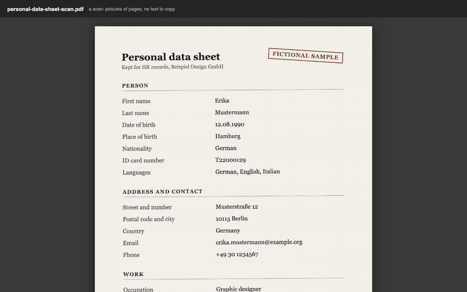

# Offee

An office assistant that runs on your own machine without being able to touch it. It keeps
the profiles you act as, the personas that do the work and the documents each may use, and
runs everyday office work on local models: filling and signing forms, writing reviews from
notes or recorded talks, translating, and drafting replies to emails and chats.

Nothing leaves the machine unless you open the switch, and the app cannot open it itself.



A scan of a personal data sheet is read into a new profile, checked and saved; then a tenant
form is opened and filled from that profile. Recorded on a Mac against the real app and its
local model; the two waits for the model (about 5 and 1½ minutes) are cut and marked. Every
person and number in it is made up;
the two documents are in [`docs/demo`](docs/demo) to try yourself.

## In plain words

**What it is.** Offee is a helper for paperwork that lives on your own computer. You give it
your documents (an ID scan, a contract, an email, notes from a meeting) and ask it to do the
dull part: fill in a form with your details, draft a reply, translate a letter, sum up a
meeting. It does the work with an AI that runs on your Mac, not on someone else's server.

**How it works.** Think of a locked office inside your computer. Offee works in that office
with its own copy of everything you hand it through the door, and nothing else: it cannot look
at your other files, and the office has no phone line to the outside. When you want an answer
from a bigger online AI, you hold the key: you open the door for one request, see exactly what
would leave, and say yes or no. Offee itself cannot open it.

**Why not just use Google or an online AI?**

- **Your papers stay with you.** Pasting a passport, a payslip or a contract into a website
  means a copy now sits on a company's servers, under their rules, possibly used to train their
  next model. With Offee nothing leaves your computer unless you let it, request by request.
- **It knows your own documents.** A search engine knows the web, not your rental contract.
  Offee answers from the files you gave it and shows which one each answer came from.
- **It does the task, not just the talk.** It fills the actual PDF form and can sign it; it
  writes the reply in your name and tone; it translates a whole document, paragraph by paragraph.
- **No account, works offline.** Once it is installed, it needs no internet
  at all.
- **You can check everything.** Every run is logged: what went in, which model answered and
  whether anything left the computer.

**What to expect.** A model that fits on a laptop is slower than the big online ones and can
be wrong, so Offee always shows its suggestions for you to check before anything is saved. It
needs a Mac with Apple Silicon or a Linux PC, and 16 GB of memory.

## Concepts

- **Profile:** an identity you act as. Name, role, contact details used in forms, signature
  image and signing certificate, languages, tone. One person usually keeps several (personal,
  employee, company director), so there are no accounts: one unlock opens them all. "Read from
  a document" fills a profile from an ID, a CV or a scan, for you to check before saving.
- **Persona:** an assistant role, such as "contract reviewer" or "support replier". It holds
  instructions, the model to use, the tools it may call and whether it may use a remote model.
- **Knowledge:** documents assigned to a profile or a persona, indexed so answers can cite
  them.
- **Workflow:** a template, written as data, with its inputs, steps, persona and output.
- **Run:** the record of one workflow run: inputs, model, anything that left the machine, and
  the output.

## Workflows

| Workflow            | In                                        | Out                                   |
| ------------------- | ----------------------------------------- | ------------------------------------- |
| Fill and sign       | a PDF form and a profile                  | the filled PDF, signed                |
| Read into a profile | an ID, a CV or a scan of either           | the person's details, to check and save |
| Review              | notes, text, or a recording of a talk     | a structured review, DOCX or PDF      |
| Translate           | a document and a target language          | the document translated, layout kept  |
| Draft a reply       | an email (`.eml`, `.mbox`) or chat thread | a reply grounded in your knowledge    |

## Isolation


Offee runs in a Linux VM that shares no folder with the Mac, in containers on a network that
leads nowhere. The gateway is the only way out, and only the switch on the Mac moves it:
**Sealed** lets nothing out, **Ask** shows each request and waits for your yes, **Open for N
minutes** closes again on its own. The switch talks to the gateway through the VM's container
socket, which the app never gets, so a hostile document cannot open it. Whatever a document
says, a persona keeps only the tools its definition gives it.

### Your information


### Encryption


Offee relies on FileVault for now. A volume that opens only with your passphrase is
[#3](https://github.com/cnotv/offee/issues/3).

### What gets installed


## Models

- **Local, the default:** llama.cpp serves the chat model, embeddings and reranker;
  whisper.cpp transcribes; Tesseract 5.5 (English, German and Italian data, Apache 2.0, from Alpine's signed packages) reads scans and photos. On Apple Silicon the GPU reaches the VM
  through Colima's `krunkit` VM type.
- **Remote, only through the switch:** Claude and other providers, per persona.
- **Updates without a network (planned, [#9](https://github.com/cnotv/offee/issues/9)):** models
  shipped as signed bundles, verified offline and imported through the browser. Today they
  download during setup.

## Platforms

macOS on Apple Silicon, and Linux on x64 and arm64. Windows (WSL2) later.

## Prior art

Nothing found does all of this; these do parts of it and are reused or copied where they fit.

- **Personas with documents:** [Open WebUI](https://docs.openwebui.com/features/workspace/models)
  custom models, [AnythingLLM](https://anythingllm.com/desktop),
  [Msty](https://docs.msty.studio/knowledge-stacks/overview). None isolates itself.
- **Office suite with local AI:** [Nextcloud Hub](https://docs.nextcloud.com/server/stable/admin_manual/ai/app_llm2.html).
  Heavy, and no documented offline install.
- **Agent sandboxes:** [Docker Sandboxes](https://docs.docker.com/ai/sandboxes/security/)
  (the gateway adding API keys itself is copied from their proxy),
  [Beachead](https://awesome.ecosyste.ms/projects/github.com%2Fbeachead-dev%2Fbeachead),
  [microsandbox](https://github.com/superradcompany/microsandbox).
- **Engines:** [Stirling-PDF](https://computingforgeeks.com/self-host-stirling-pdf-docker/),
  [ai-pdf-autofiller](https://awesome.ecosyste.ms/projects/github.com%2Flindseystead%2Fai-pdf-autofiller)
  (rules first, AI only for leftover fields),
  [doc-translator](https://github.com/JiGuangYa/doc-translator),
  [Scriberr](https://github.com/yb235/Scriberr).

## Try it

### The Mac app

On a Mac with Apple Silicon (macOS 13 or later, 16 GB of memory or more) with
[Homebrew](https://brew.sh):

1. Download `Offee-arm64.dmg` from the
   [Mac preview release](https://github.com/cnotv/offee/releases/tag/mac-preview) and drag Offee to
   Applications.
2. The app is not notarized yet, so the first time right-click it and choose **Open** (on
   macOS 15: open it once, then allow it in System Settings, Privacy & Security).
3. Choose **Set up Offee**. When setup finishes, Offee opens in its own window.

The menu bar icon holds the switch. In **Ask** mode every outbound request appears as a Mac
dialog showing exactly what would be sent; the page inside the VM can neither draw nor answer
that dialog. **Settings and setup…** stores the Anthropic key, runs the isolation check, and
starts or stops the VM. Quitting the app stops the VM. When something goes wrong, **Show log
file** in the same menu opens `~/Library/Logs/Offee/offee.log`, which holds every launcher run
and error.

The window that shows Offee is a locked-down browser: no Node.js, no bridge to the app, no
permissions but copying text, and no request, link or navigation off `127.0.0.1:8470`. That
last part matters: the page comes from the VM but runs on the Mac, which has a network. In an
ordinary browser a compromised app could send data out from the page itself, around the
gateway; the Mac app's window cannot, because the host blocks it, not the page.

### The Linux app

On Linux (x64 or arm64, 16 GB of memory or more, with virtualization turned on so `/dev/kvm`
exists):

1. Install [Colima](https://colima.run) and the Docker CLI with Compose.
2. Download the package for your machine from the
   [Linux preview release](https://github.com/cnotv/offee/releases/tag/linux-preview).
   On Debian or Ubuntu, install the `.deb`:

   ```sh
   sudo apt install ./Offee-linux-x64.deb
   ```

   Elsewhere, unpack the `.tar.gz` and make Chromium's sandbox helper setuid root, which the
   `.deb` does for you; Offee keeps its sandbox on rather than starting without one:

   ```sh
   tar -xzf Offee-linux-x64.tar.gz
   sudo chown root:root Offee-linux-x64/chrome-sandbox
   sudo chmod 4755 Offee-linux-x64/chrome-sandbox
   ./Offee-linux-x64/offee
   ```

3. Open Offee from your applications and choose **Set up Offee**.

It works like the Mac app, with the tray icon in place of the menu bar icon. Desktops that
show no tray icon (GNOME without an AppIndicator extension) still work: open Offee again from
your applications to bring its window back. The log is `~/.config/Offee/logs/offee.log`.

### From the terminal

The same, without the app:

```sh
gh repo clone cnotv/offee
cd offee
./bin/offee setup
```

`setup` first checks the machine: the platform, memory, free disk space (25 GB), that port
8470 is free and that the download sites answer. It also clears what an earlier attempt left
behind, such as a stalled download or a VM that would not start, and picks a smaller model on
a machine with less than 16 GB of memory. `offee check` runs the same check on its own. Then
`setup` installs Colima and the Docker CLI if they are missing, creates the VM, builds the
images and downloads the models (about 10 GB the first time), then opens Offee at
<http://127.0.0.1:8470>. Downloads happen only during setup, before the app starts.

On Linux, install [Colima](https://colima.run) and the Docker CLI with Compose first, then run
the same command.

| Command | What it does |
| --- | --- |
| `offee setup [--gpu]` | First install. `--gpu` uses Colima's experimental `krunkit` VM type for the Mac's GPU |
| `offee start` / `stop` / `status` / `open` / `logs` | Run and inspect it |
| `offee switch seal` / `ask` / `open 15` | What may leave the machine. Every start is sealed |
| `offee watch` | Approve or deny requests waiting in ask mode, seeing exactly what would be sent |
| `offee key anthropic` | Store the key the gateway uses for Claude. The app never sees it |
| `offee model list` / `use <repo>` | See or change the local model |
| `offee selftest` | Prove the app reaches neither the internet nor the host |
| `offee update` | Rebuild after `git pull` |
| `offee destroy` | Delete the VM and everything in it |

Start with a profile and a persona, add a few documents to the library, then try each workflow.
To let a persona use Claude: set it to "Remote when the switch allows", run `offee key anthropic`,
then `offee switch ask` and `offee watch` in a second terminal.

### What this first build does not do yet

- **Encryption at rest of its own:** data sits in the VM's disk, inside your user folder, which
  FileVault encrypts. A passphrase-unlocked volume is [#3](https://github.com/cnotv/offee/issues/3).
- **Translation layout:** paragraphs are kept, tables and styling are not.
- **Signatures:** the PDF signature is a CAdES detached signature with a self-signed
  certificate, valid and tamper-evident, but it lacks the signing-certificate attribute a strict
  PAdES B-B validator asks for ([#7](https://github.com/cnotv/offee/issues/7)).
- **Model bundles:** models download from Hugging Face during setup; offline bundles are [#9](https://github.com/cnotv/offee/issues/9).

## Development

```sh
pnpm install
pnpm dev        # API on 8470 (expects the model servers), UI on 5319
pnpm lint --max-warnings 0 && pnpm typecheck && pnpm test
pnpm --filter @offee/desktop start   # the Mac app, against the launcher in this checkout
```

Netlify publishes the UI alone for every pull request, in **demo mode** (`VITE_DEMO_MODE=1`, set in
`netlify.toml`): sample profiles, documents and runs, and canned answers held in the browser tab,
since no Offee server runs there. `VITE_DEMO_MODE=1 pnpm --filter @offee/web dev` runs the same
locally. A build without it carries no demo code.

## Status

A first test build ([#10](https://github.com/cnotv/offee/issues/10)). The roadmap is the issue tracker.
