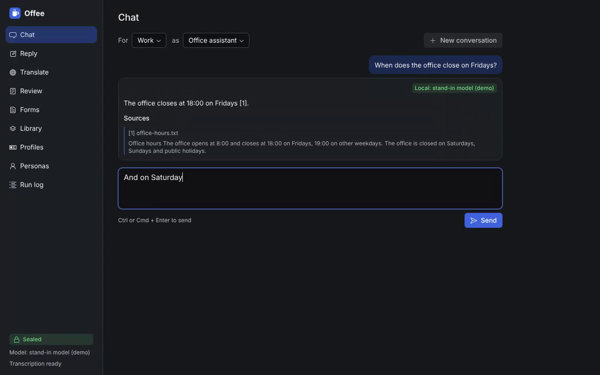

# Offee

An office assistant that runs on your own machine without being able to touch it. It keeps
the profiles you act as, the personas that do the work and the documents each may use, and
runs everyday office work on local models: filling and signing forms, writing reviews from
notes or recorded talks, translating, and drafting replies to emails and chats.

Nothing leaves the machine unless you open the switch, and the app cannot open it itself.

[](docs/media/offee-features.mp4)

[Watch the 70-second walkthrough](docs/media/offee-features.mp4). It was recorded against a
stand-in model, so the answers are canned and the model badge reads "stand-in model (demo)".

## Concepts

- **Profile:** an identity you act as. Name, role, contact details used in forms, signature
  image and signing certificate, languages, tone. One person usually keeps several (personal,
  employee, company director), so there are no accounts: one unlock opens them all.
- **Persona:** an assistant role, such as "contract reviewer" or "support replier". It holds
  instructions, the model to use, the tools it may call and whether it may use a remote model.
- **Knowledge:** documents assigned to a profile or a persona, indexed so answers can cite
  them.
- **Workflow:** a template, written as data, with its inputs, steps, persona and output.
- **Run:** the record of one workflow run: inputs, model, anything that left the machine, and
  the output.

## Workflows

| Workflow            | In                                        | Out                                   |
| ------------------- | ----------------------------------------- | ------------------------------------- |
| Fill and sign       | a PDF form and a profile                  | the filled PDF, signed                |
| Review              | notes, text, or a recording of a talk     | a structured review, DOCX or PDF      |
| Translate           | a document and a target language          | the document translated, layout kept  |
| Draft a reply       | an email (`.eml`, `.mbox`) or chat thread | a reply grounded in your knowledge    |

## Isolation

```
 host (macOS / Linux)                       VM (Colima)
┌──────────────────────────┐   ┌──────────────────────────────────────────┐
│ launcher (bin/offee)     │   │  app container        no network,        │
│  - start / stop the VM   │   │  (UI, API, data)      no host folders    │
│  - unlock the volume     │   │        │ internal network only           │
│  - the switch: sealed /  │──►│  gateway container ── the only way out,  │
│    ask / open for N min  │   │        │              closed by default  │
│  - approval prompts      │   │  inference container  llama.cpp,         │
│ browser ── 127.0.0.1 ────┼──►│  (GPU via krunkit)    whisper.cpp        │
└──────────────────────────┘   └──────────────────────────────────────────┘
```

- **The VM is the wall.** Colima runs one Linux VM, configured with no shared folders. The
  app's data lives on an encrypted volume inside it.
- **Files come and go through the browser.** You upload what the app may read and download
  what it produces. It never reads a host path.
- **The app container has no network.** It reaches only the inference and gateway containers
  on an internal network.
- **The gateway is the only way out.** It forwards to listed hosts only, adds API keys itself,
  and obeys the switch:
  - **Sealed:** nothing leaves.
  - **Ask:** each request waits for your approval and shows exactly what would be sent.
  - **Open for N minutes:** closes again on its own.
- **Only the host launcher holds the switch.** It controls the gateway through the VM's
  container socket, which the app container never gets, so a hostile document cannot open it.
- **Documents are untrusted.** Whatever a document says, a persona keeps the tools its
  definition gives it, and the closed gateway means nothing can be smuggled out.

## Models

- **Local, the default:** llama.cpp serves the chat model, embeddings and reranker;
  whisper.cpp transcribes; Tesseract reads scans. On Apple Silicon the GPU reaches the VM
  through Colima's `krunkit` VM type.
- **Remote, only through the switch:** Claude and other providers, per persona.
- **Updates without a network:** models ship as signed bundles, verified offline and imported
  through the browser. A manifest pins each by name, hash and licence.

## Platforms

macOS on Apple Silicon first, then Linux. Windows (WSL2) later.

## Prior art

Nothing found does all of this; these do parts of it and are reused or copied where they fit.

- **Personas with documents:** [Open WebUI](https://docs.openwebui.com/features/workspace/models)
  custom models, [AnythingLLM](https://anythingllm.com/desktop),
  [Msty](https://docs.msty.studio/knowledge-stacks/overview). None isolates itself.
- **Office suite with local AI:** [Nextcloud Hub](https://docs.nextcloud.com/server/stable/admin_manual/ai/app_llm2.html).
  Heavy, and no documented offline install.
- **Agent sandboxes:** [Docker Sandboxes](https://docs.docker.com/ai/sandboxes/security/)
  (the gateway adding API keys itself is copied from their proxy),
  [Beachead](https://awesome.ecosyste.ms/projects/github.com%2Fbeachead-dev%2Fbeachead),
  [microsandbox](https://github.com/superradcompany/microsandbox).
- **Engines:** [Stirling-PDF](https://computingforgeeks.com/self-host-stirling-pdf-docker/),
  [ai-pdf-autofiller](https://awesome.ecosyste.ms/projects/github.com%2Flindseystead%2Fai-pdf-autofiller)
  (rules first, AI only for leftover fields),
  [doc-translator](https://github.com/JiGuangYa/doc-translator),
  [Scriberr](https://github.com/yb235/Scriberr).

## Try it

### The Mac app

On a Mac with Apple Silicon (macOS 13 or later, 16 GB of memory or more) with
[Homebrew](https://brew.sh):

1. Download `Offee-arm64.dmg` from the
   [Mac preview release](https://github.com/cnotv/offee/releases/tag/mac-preview) and drag Offee to
   Applications.
2. The app is not notarized yet, so the first time right-click it and choose **Open** (on
   macOS 15: open it once, then allow it in System Settings, Privacy & Security).
3. Choose **Set up Offee**. When setup finishes, Offee opens in its own window.

The menu bar icon holds the switch. In **Ask** mode every outbound request appears as a Mac
dialog showing exactly what would be sent; the page inside the VM can neither draw nor answer
that dialog. **Settings and setup…** stores the Anthropic key, runs the isolation check, and
starts or stops the VM. Quitting the app stops the VM. When something goes wrong, **Show log
file** in the same menu opens `~/Library/Logs/Offee/offee.log`, which holds every launcher run
and error.

The window that shows Offee is a locked-down browser: no Node.js, no bridge to the app, no
permissions but copying text, and no request, link or navigation off `127.0.0.1:8470`. That
last part matters: the page comes from the VM but runs on the Mac, which has a network. In an
ordinary browser a compromised app could send data out from the page itself, around the
gateway; the Mac app's window cannot, because the host blocks it, not the page.

### From the terminal

The same, without the app:

```sh
gh repo clone cnotv/offee
cd offee
./bin/offee setup
```

`setup` first checks the machine: the platform, memory, free disk space (25 GB), that port
8470 is free and that the download sites answer. It also clears what an earlier attempt left
behind, such as a stalled download or a VM that would not start, and picks a smaller model on
a machine with less than 16 GB of memory. `offee check` runs the same check on its own. Then
`setup` installs Colima and the Docker CLI if they are missing, creates the VM, builds the
images and downloads the models (about 10 GB the first time), then opens Offee at
<http://127.0.0.1:8470>. Downloads happen only during setup, before the app starts.

On Linux, install [Colima](https://colima.run) and the Docker CLI with Compose first, then run
the same command.

| Command | What it does |
| --- | --- |
| `offee setup [--gpu]` | First install. `--gpu` uses Colima's experimental `krunkit` VM type for the Mac's GPU |
| `offee start` / `stop` / `status` / `open` / `logs` | Run and inspect it |
| `offee switch seal` / `ask` / `open 15` | What may leave the machine. Every start is sealed |
| `offee watch` | Approve or deny requests waiting in ask mode, seeing exactly what would be sent |
| `offee key anthropic` | Store the key the gateway uses for Claude. The app never sees it |
| `offee model list` / `use <repo>` | See or change the local model |
| `offee selftest` | Prove the app reaches neither the internet nor the host |
| `offee update` | Rebuild after `git pull` |
| `offee destroy` | Delete the VM and everything in it |

Start with a profile and a persona, add a few documents to the library, then try each workflow.
To let a persona use Claude: set it to "Remote when the switch allows", run `offee key anthropic`,
then `offee switch ask` and `offee watch` in a second terminal.

### What this first build does not do yet

- **Encryption at rest of its own:** data sits in the VM's disk, inside your user folder, which
  FileVault encrypts. A passphrase-unlocked volume is [#3](https://github.com/cnotv/offee/issues/3).
- **Scanned documents:** text must be selectable; OCR comes later.
- **Translation layout:** paragraphs are kept, tables and styling are not.
- **Signatures:** the PDF signature is a CAdES detached signature with a self-signed
  certificate, valid and tamper-evident, but it lacks the signing-certificate attribute a strict
  PAdES B-B validator asks for ([#7](https://github.com/cnotv/offee/issues/7)).
- **Model bundles:** models download from Hugging Face during setup; offline bundles are [#9](https://github.com/cnotv/offee/issues/9).

## Development

```sh
pnpm install
pnpm dev        # API on 8470 (expects the model servers), UI on 5319
pnpm lint --max-warnings 0 && pnpm typecheck && pnpm test
pnpm --filter @offee/desktop start   # the Mac app, against the launcher in this checkout
```

Netlify publishes the UI alone for every pull request, in **demo mode** (`VITE_DEMO_MODE=1`, set in
`netlify.toml`): sample profiles, documents and runs, and canned answers held in the browser tab,
since no Offee server runs there. `VITE_DEMO_MODE=1 pnpm --filter @offee/web dev` runs the same
locally. A build without it carries no demo code.

## Status

A first test build ([#10](https://github.com/cnotv/offee/issues/10)). The roadmap is the issue tracker.
